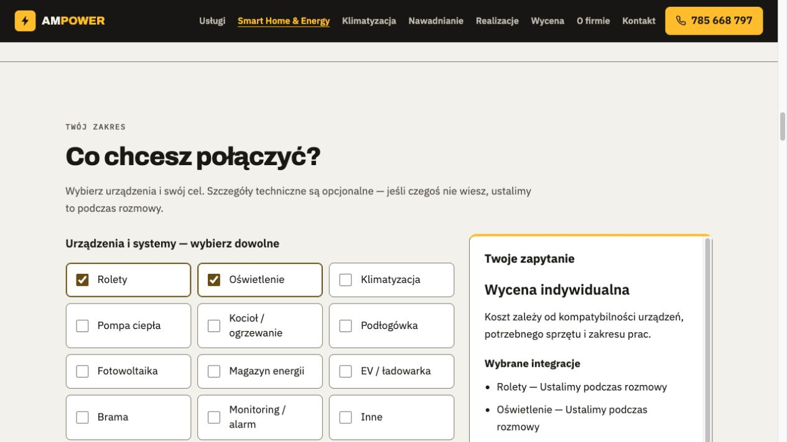

# AMPOWER Smart Home & Energy — implementacja MVP, etap 5/6

Data: 2026-10-11. Status: **lokalne MVP wykonane i zweryfikowane; bez publikacji**.
Repozytorium: `ampower-website`, gałąź `feat/smart-home-energy-mvp`, baza
`2f9be19a61c52aed390a53a2a1b5bd67a049ea69`.

## Podstawa i bezpieczeństwo zmian

Przeczytano specyfikację [UX](../../../docs/ampower-smart/04_UX_SPEC.md),
[treści](../../../docs/ampower-smart/04_TRESCI_STRONY.md),
[audyt wskazany w zadaniu](../../../docs/ampower-smart/01_AUDYT.md),
[logikę cen](../../../docs/ampower-smart/03_CENNIK_LOGIKA.md) i
[uzupełniony audyt repozytorium](../../01_AUDYT.md).
Wcześniejsze ograniczenie etapu 4 do dokumentacji zastępuje obecne zlecenie implementacji;
zakaz publikacji pozostaje w mocy.

Właściwe repo jest w `/Users/jb/Ampower Smart Home/ampower-website`.
Nie używano pustego nadrzędnego repo z katalogu domowego do operacji zapisu Git.
Trzy zastane nieśledzone dokumenty (`00_BRIEF.md`, `01_AUDYT.md`, `PLAN_ETAPOW.md`)
zachowano bez zmian. Nie wykonano stage, commit, push, deploy, zmian DNS,
konfiguracji hostingu, kluczy ani migracji. `CNAME` i favicon pozostały bez zmian.

Przed edycją odczytano publiczny HTML `https://ampower.pl/`: HTTP 200,
1 968 684 bajty, identyczny bajtowo z lokalnym źródłem. To porównanie źródeł,
nie audyt produkcyjnych formularzy, infrastruktury pocztowej lub urządzeń klientów.

## Zmienione i dodane pliki

| Plik / katalog | Zmiana i cel |
| --- | --- |
| [index.html](../../index.html) | Link usługi po „Usługi”, karta w sekcji usług, link w stopce; próg menu 1200 px, Escape z powrotem fokusu; aktualizacja nagłówka sekcji usług |
| [smart-home-energy/index.html](../../smart-home-energy/index.html) | Osobna podstrona, polska oferta, scenariusze, formularz, pakiety, dwa sposoby realizacji, wsparcie, FAQ i kontakt |
| [smart-home-energy/data.js](../../smart-home-energy/data.js) | Katalog 12 kategorii, jednostki, opcje, kontakt i jawna polityka indywidualnej wyceny; bez stawek z hipotez etapu 3 |
| [smart-home-energy/model.js](../../smart-home-energy/model.js) | Warunkowe pola, walidacja, ocena zakresu, filtracja zapytania i generator pełnej treści e-maila |
| [smart-home-energy/app.js](../../smart-home-energy/app.js) | Powiązanie UI z modelem, panele, aktualizacja podsumowania, błędy, podgląd wiadomości, schowek i menu |
| [smart-home-energy/style.css](../../smart-home-energy/style.css) | Responsywność, jasny/ciemny motyw systemowy, focus, formularz, karty i ograniczenie ruchu |
| `smart-home-energy/fonts/` | Sześć istniejących fontów WOFF2 wyodrębnionych z osadzeń strony głównej; lokalny `fonts.css`, bez pobierania fontów od dostawcy |
| [package.json](../../package.json), [.gitignore](../../.gitignore) | Polecenia test/lint/build/dev bez zależności; ignorowanie lokalnego `dist/` |
| [scripts/build.js](../../scripts/build.js) | Statyczny build z jawną listą zasobów publicznych |
| [scripts/lint.js](../../scripts/lint.js), [scripts/lint_html.py](../../scripts/lint_html.py) | Kontrole składni JS/JSON-LD oraz struktury i odsyłaczy HTML |
| [tests/smart.test.js](../../tests/smart.test.js) | Logika konfiguratora, kontakt, walidacja i bezpieczne zapytanie |
| [tests/legacy.test.js](../../tests/legacy.test.js) | Regresje istniejącego kalkulatora i kontrola niezmienności jego kodu |
| [tests/presentation.test.js](../../tests/presentation.test.js) | Kontrast zdefiniowanych palet, metadata i wariant lokalny |
| [README.md](../../README.md) | Instrukcja podglądu i weryfikacji; opis kontaktu i buildu |
| [05_KONFIGURATOR.jpg](05_KONFIGURATOR.jpg), ten raport | Dowód lokalnego podglądu i zakres odbioru |

Zmiany są lokalne, nowe pliki nie są jeszcze śledzone. Nie instalowano żadnego pakietu.
Strona główna zachowuje monolityczny HTML/CSS/JS. Nie dodano SPA, routera, frameworka,
bazy, endpointu, kont ani płatnej usługi. Nowa podstrona ma około 30 KB HTML;
cały jej katalog ma około 181 KB z lokalnymi fontami, zamiast kopii prawie 2 MB strony głównej.

## Konfigurator i wycena

Podstawowa ścieżka wymaga jednej kategorii, jednego celu i kontaktu w wybranym kanale.
Wszystkie 12 kategorii są dostępne od początku. Szczegóły są zwinięte i opcjonalne.
Pusta liczba oznacza „Nie wiem”; jest też jawny przycisk o tej nazwie.
Podana liczba musi być całkowita, 1–999. Zero, ułamki, wartości ujemne,
notacja wykładnicza i większe wartości nie są po cichu zaokrąglane.

Rolety rozróżniają centralę/bramkę, osobny sterownik na napęd, przyciski i układ mieszany.
Model centrali/sterownika lub opis mieszany pojawiają się tylko w odpowiedniej gałęzi.
Jedna roleta jest jednym napędem; strefa podłogówki jest strefą temperatury,
a jednostka klimatyzacji oznacza jednostkę wewnętrzną.
Monitoring i alarm mają trzy oddzielne gałęzie liczby kamer/central.
Wspólny system PV i magazynu jest opisany w podsumowaniu bez automatycznego
przypisywania dwóch integracji. Potrzeba montażu przy wybranej realizacji zdalnej
oraz sterowanie magazynem/regulacja mocy EV uruchamiają informację o kwalifikacji.

Odznaczone kategorie, ukryte pola techniczne, miejscowość przy realizacji zdalnej,
gotowość zdalna przy realizacji lokalnej i drugi kanał kontaktu nie trafiają do zapytania
i nie są walidowane. Odpowiedzi można zachować wyłącznie w pamięci bieżącej strony
na potrzeby ponownej edycji. Zmiana po przygotowaniu wiadomości unieważnia stary szkic.

**Zawsze „Wycena indywidualna”.** Etap 3 zawiera hipotezy, więc nie przeniesiono jego
stawek, przykładów, VAT, narzutów ani widełek do kodu publicznego. Model zwraca
`price: null` i `priceListVersion: null`, nigdy nieznane „0 zł”. Wyświetla podział:
sprzęt i materiały, instalacja, konfiguracja; dojazd/wysyłka, usługi zewnętrzne i opieka osobno.
Nie zaimplementowano pozornego przełącznika „zatwierdzono”, który odblokowałby hipotetyczne ceny.
Przyszła kalkulacja kwot wymaga osobnej, zatwierdzonej wersji danych i implementacji jej warunków.

## Kontakt i prywatność — wariant przejściowy

Repozytorium i GitHub Pages nie mają odbiornika formularzy. Ponownie użyto istniejącego
odbiorcy `kuba@ampower.pl` i telefonu `785 668 797`, przez obecny model kontaktu.
CTA **„Przygotuj e-mail z konfiguracją”** waliduje i pokazuje pełny szkic oraz osobny
link **„Otwórz aplikację pocztową”**. Użytkownik sam wysyła wiadomość w swojej aplikacji.
Preferowany kontakt telefoniczny oznacza prośbę o telefon w treści takiego zapytania.
Nie oznacza automatycznego wysłania SMS-a lub połączenia.

Nie ma komunikatu „wysłano” ani „przyjęto”. Kliknięcie `mailto:` nie potwierdza dostarczenia.
Brak aplikacji można obsłużyć podglądem tekstu, przyciskiem **„Kopiuj konfigurację”**
i widocznym adresem. Powyżej 8000 znaków zakodowanego URI link z pełną treścią jest ukryty;
to ostrożny próg implementacyjny, nie gwarancja obsługi przez każdą aplikację pocztową.
Tekst pozostaje kompletny i możliwy do skopiowania. Odmowa/niedostępność schowka
ma komunikat i możliwość ręcznego zaznaczenia pełnej treści. SMS nie służy do przenoszenia
rozbudowanej konfiguracji. Nie wysłano żadnej testowej wiadomości.

Nie dodano sekretów, integracji z dostawcą ani automatycznego żądania z danymi.
Nowa podstrona nie uruchamia analityki i nie zapisuje zapytania w cookies, localStorage,
sessionStorage, URL strony ani logach. Treść trafia do schowka lub aplikacji pocztowej
dopiero po działaniu użytkownika. Przed wysłaniem można ją przejrzeć.
Nie ma nieuzgodnionej zgody marketingowej, martwego linku do polityki ani wymyślonej retencji.

Pełna informacja o przetwarzaniu otrzymanych wiadomości nie została dostarczona przez właściciela.
Podstrona uczciwie opisuje ten brak jako element lokalnego podglądu. Nie zastępuje to obowiązków
firmy dotyczących obsługi poczty. Z tego powodu i zgodnie ze specyfikacją nowa strona ma
**`noindex, nofollow`**. Nie jest gotowa do bezwarunkowej publikacji.
Dotychczasowa analityka strony głównej nie została rozszerzona ani naprawiona w tym zakresie.

## Lokalny podgląd i build

W katalogu repozytorium, z Node.js 20+ i Python 3:

```sh
cd '/Users/jb/Ampower Smart Home/ampower-website'
npm test
npm run lint
npm run build
npm run dev
```

Adres: http://127.0.0.1:4173/smart-home-energy/ . Strona główna: http://127.0.0.1:4173/ .
Nie używać `file://`, bo konfigurator importuje lokalne moduły JavaScript.
Nie potrzeba `npm install`. Serwer podglądu jest związany tylko z `127.0.0.1`.
Serwer użyty do QA został zatrzymany po zakończeniu; powyższe polecenie uruchamia go ponownie.

`npm run build` tworzy ignorowany `dist/`, kopiując tylko stronę główną, favicon, CNAME
i katalog nowej podstrony. Dokumentacja, testy i narzędzia nie trafiają do tego artefaktu.
Nie zmieniono jednak źródła GitHub Pages na `dist/`: obecne Pages nadal publikuje root `main`.
Przed przyszłym deployem trzeba osobno rozstrzygnąć sposób wykluczenia dokumentów z publikacji.
Samo utworzenie artefaktu nie zabezpiecza źródłowej gałęzi przed taką publikacją.



## Raport testów wykonanych

| Kontrola | Faktyczny wynik |
| --- | --- |
| `npm test` | **88/88 PASS**, 0 pominiętych: 55 testów modelu/formularza, 11 testów regresji i 22 testy prezentacji/kontrastu |
| `npm run lint` | PASS: składnia plików JS i inline, JSON-LD, H1, unikalne ID, etykiety pól, cele ARIA, lokalne pliki i fragmenty; kontrola braku niebezpiecznych operacji w nowym konfiguratorze |
| `npm run build` | PASS: statyczny `dist/`, brak publikacji |
| `git diff --check` | PASS |
| Kod istniejącego kalkulatora | Cały blok `CENNIK` i logiki porównany bajtowo z HEAD: identyczny |
| Przeglądarka, prosta ścieżka | Kategoria + cel + e-mail z „+”, bez modeli → pełny szkic, cena indywidualna, właściwy komunikat |
| Przeglądarka, błędy | Puste wymagane grupy i kontakt; 0 rolet → błędy tekstowe, focus `error-summary`, wpis zachowany; korekta usuwa błąd |
| Przeglądarka, warunkowe pola | Centrala rolet → przyciski; e-mail → telefon zagraniczny; lokalnie/zdalnie; trzy gałęzie monitoringu/alarmu; PV/magazyn i odznaczenie PV — prawidłowe ukrywanie, wyłączenie i wykluczenie treści |
| Przeglądarka, duża konfiguracja | 12 kategorii + 1000 polskich znaków uwag: pełne 5104 znaki wiadomości, brak obcięcia, fallback długiego URI, kopiowanie potwierdzone przez interfejs |
| Przeglądarka, etykiety dynamiczne | 0 pól bez etykiety, 0 brakujących powiązań `aria-describedby`; 12 kategorii |
| Klawiatura | Space zaznacza kategorię; Escape zamyka menu i wraca na przycisk; focus błędów oraz podglądu potwierdzony |
| Responsywność nowej podstrony | 320, 360, 390, 768, 880, 881, 1024, 1100, 1201 i 1440 px: bez poziomego przepełnienia; siatka 1/2/3 kolumn, menu zwinięte do 1200 px |
| Menu strony głównej | 320, 881, 1024, 1100, 1201 i 1440 px: nowy link dostępny i bez kolizji; Escape sprawdzony |
| Brak modułu JS | Tymczasowa kopia bez skryptu: ukryty konfigurator, widoczny kontakt alternatywny, treść oferty, H1 i 14 pytań FAQ |
| Konsola nowej podstrony | Brak odnotowanych błędów i ostrzeżeń podczas sprawdzonych przepływów |
| Kontrast | Obie palety: ink/muted/accent/error na bg/surface ≥4,5:1; obramowanie pól i focus na tle ≥3:1; ciemny tekst na żółtym przycisku ≥4,5:1 |

Linter jest lokalnym zestawem kontroli, nie pełnym ESLint/stylelint ani walidatorem WCAG.
Pomiary kontrastu dotyczą zdefiniowanych kombinacji kolorów, nie pełnego audytu wszystkich
stanów przeglądarki i kontrolek systemowych. Testy modelu wykonano w Node, regresje
starego kalkulatora w VM z uproszczonym DOM, a opisane przepływy UI w przeglądarce Codex.

Pierwszy przebieg miał 65/66 PASS: test porównania dużego HTML przekroczył domyślny bufor
procesu `git show`. Zwiększono bufor narzędzia testowego; kolejne przebiegi przeszły.
Nie była to zmiana ani błąd cennika. Końcowy wynik obejmuje później dodane testy kontrastu.

Testy regresji według audytu: elektryka 12 punktów 1700–2400 zł; split 4050–6150;
7 pomieszczeń 22100–37050; 4 kamery 3350–5400; nawadnianie 300 m² 7900–9500;
brak zakresu „—”; istniejący dodatek Wi-Fi bez powierzchni 800–1000;
limit elektryki 999 punktów 139850–199800. Są to **wyniki starego kalkulatora**,
nie cennik nowej usługi ani potwierdzenie aktualności cen rynkowych.

Przy 320 px stara sekcja kontaktu strony głównej ma około 6 px przepełnienia
w stosunku do szerokości obszaru treści. Porównanie z kopią HEAD wykazało to samo
zachowanie przed zmianami; nie dotyczy nowego formularza ani menu i nie było naprawiane.
Tymczasowe kopie QA strony głównej pomijały jedynie zewnętrzny loader analityki.
Wszystkie pliki tymczasowych stron QA usunięto przed końcowym buildem.

## Niewykonane kontrole i decyzje właściciela

Nie wykonano: rzeczywistej wysyłki/dostarczenia poczty lub SMS, testów odbiornika
backendowego (nie istnieje), wymuszonej odmowy schowka, testów aplikacji pocztowych
na fizycznym iOS/Android, pełnego VoiceOver/NVDA, rzeczywistego zoomu 200/400%,
pomiarów Core Web Vitals, badań 5 użytkowników ani fizycznych testów kompatybilności.
Wąski viewport sprawdza układ odpowiadający reflow, nie zastępuje testu zoomu i czytnika.
Te kontrole pozostają do odbioru w etapie 6; nie przedstawiamy ich jako zaliczonych.

Przed publikacją właściciel powinien rozstrzygnąć:

1. Informację o danych dla faktycznej obsługi wiadomości: administrator/kontakt,
   podstawa, odbiorcy/dostawca poczty, dostęp, retencja, prawa i ewentualne transfery.
   Potwierdzić odbiorcę zapytań nowej usługi. Sam szkic lokalny nie wymaga zgody marketingowej.
2. Zakresy i nazwy START/STANDARD/PREMIUM, fizycznie sprawdzone modele/funkcje,
   warunki zdalnej centralki, obszar montażu i zasady wsparcia. MVP nie obiecuje
   uniwersalnej zgodności, terminu odpowiedzi, SLA ani gwarantowanych oszczędności.
3. Czy pozostaje ręczne wysyłanie e-maila, czy potrzebny jest zatwierdzony odbiornik HTTPS.
   Dla nowego odbiornika dopiero po tej decyzji: bezpieczeństwo, spam/limity,
   walidacja po stronie odbiorcy, retencja/logi i rzeczywiste potwierdzenie przyjęcia.
4. Jeśli mają być kwoty: zatwierdzona publiczna wersja cennika, jednostki, modele,
   zakres prac, VAT, transport, aktualność materiałów i warunki widełek.
   **Zatwierdzenie cennika nie jest konieczne do pozostawienia indywidualnej wyceny.**
5. Odbiór etapu 6 i osobne polecenie publikacji: usunięcie podglądowego `noindex`,
   wykluczenie dokumentów z publicznego artefaktu/źródła Pages, ewentualna grafika OG
   oraz osobna decyzja o analityce. Nie dopisywano sitemap dla strony pozostającej w podglądzie.

Nie proszono o te decyzje jako warunek wykonania MVP. Bezpieczny wariant przejściowy
jest już działający i dostępny do lokalnego przeglądu.
