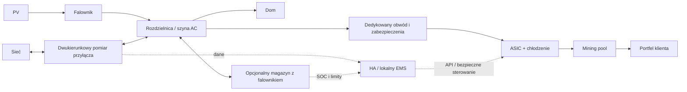

# Model ekonomiczny i architektura — rekomendacja etapu 1

## Granica produktu

Dwa interfejsy korzystają z **jednego czystego modułu JavaScript**: normalizacja wejść → profil interwałowy → dopuszczalne stany ASIC i magazynu → bilans energetyczny → rozliczenie scenariusza bazowego i alternatywnego → wynik i metadane niepewności. UI nie może zawierać drugiego kompletu wzorów. Skrypt badawczy tego raportu nie jest drugim produkcyjnym silnikiem.

Tryb prosty wybiera lokalizację, moc, przybliżony profil zużycia i ewentualną znaną nadwyżkę. Odpowiedź „nie wiem” uruchamia **oznaczoną symulację**, nie podmienia braków na pewne pomiary. PVGIS daje produkcję, ale nie zużycie domu. Znana roczna nadwyżka skaluje szacunkowy profil z kontrolą nieprzekraczania produkcji; nie wyznacza samodzielnie godzin pracy.

Tryb zaawansowany pozwala edytować parametry PV, net-billingu, ASIC, magazynu, CAPEX/OPEX i scenariuszy. Zmiany liczyć lokalnie bez przeładowania; większe serie w Web Workerze. CSV pozostaje w przeglądarce. Eksport założeń musi zawierać jednostki, źródła, daty i wersję silnika. Import `timestamp,pv_kw,load_kw` albo jednoznacznie opisane `interval_kwh`; nie zgadywać W/kW/kWh, formatu dat ani UTC/DST. Sprawdzać luki, duplikaty, ujemne zużycie, konwencję znaków, częstotliwość i interwał czasu. Dane miesięczne rozkładać na profil z ostrzeżeniem; nie dzielić nadwyżek przez moc ASIC i nazywać tego czasem pracy.

## Wzory i jednostki

- `P_W = H_TH_s × efficiency_J_TH`. Zatem 234 TH/s ×15 J/TH =3510 W. `E_kWh = Σ P_kW × Δt_h`.
- Nadwyżka przed decyzjami: `max(0, PV_AC − dom_AC)`. Dla AC z PVGIS nie odejmować ponownie strat falownika już uwzględnionych w przyjętych stratach PV. Pomiar na ścianie ASIC obejmuje jego PSU i wentylatory; dodatkową wentylację/chłodzenie liczyć osobno.
- Dla punktu pracy `j`: wymagane `P_j + P_chłodzenia`, hashrate `H_j`, koszt i czas rozruchu, minimalny stabilny czas, ograniczenia temperatur. Krzywa `H(P)` ma źródło/pomiar i firmware. Bez potwierdzenia tylko moc znamionowa oraz wyłączenie; zero liniowego skalowania TH/s przy dowolnym W.
- Z trudności: `BTC = H_TH_s ×10^12 × sekundy_hashowania ×(subsidy_BTC + średnia_fee_BTC_na_blok)/(difficulty ×2^32)` po odjęciu właściwych opłat i stale shares. Alternatywnie hashprice w BTC/PH/dzień: `BTC = H_TH_s/1000 × czas_hashowania_h/24 × hashprice`. Gdy hashprice jest już netto, nie odejmować opłaty ponownie.
- Hashprice w USD nie jest liczbą BTC. Kurs USD/PLN i BTC/PLN muszą mieć zgodne znaczenie/datę. Wartość BTC `ilość × kurs`; satoshi = BTC×100 000 000. Zaokrąglać prezentację, nie każdy interwał bilansu.
- Rozruch zużywa energię również zanim ASIC zacznie hashować. Dostępność, awarie i przestoje zmniejszają hashrate/czas, nie produkcję PV. Model zależy od typu poola FPPS/PPS/PPLNS; próg wypłaty i opłata on-chain mogą opóźnić trafienie BTC do portfela.

Snapshot API zapisany w evidence: BTC/PLN **316 113,62**; trudność **140 577 680 051 919,6**; wysokość **972 966**; średnia opłata transakcyjna z144bloków **0,01398418 BTC/blok**. Oczekiwany przychód brutto odpowiada ok. **0,00044919 BTC/PH/dzień**, czyli **141,99 PLN/PH/dzień**. To wyliczenie z chwilowej trudności i próbki opłat, nie kurs ofertowy ani prognoza roczna. Odczyt hashrate estymuje sieć; dla wzoru powyżej używamy trudności, nie mieszamy estymat z dwóch metod.

Przy założonych pool2% i dev2,5%, bez rozruchów i zewnętrznych urządzeń, wartość wydobycia/kWh wynosi ok.: S21 **0,323 PLN**, S21+ **0,343**, Pro **0,377**, XP **0,419**, S23 air **0,514**, S23 Hyd. **0,595**. Dla nieobsługiwanego firmware S23 to wyłącznie porównanie tej samej stopy potrąceń, nie deklaracja obsługi. Niższy pobór podnosi efektywność tylko według potwierdzonej krzywej, nie z założenia.

Przykład kontrolny: Pro234, 1000 godzin rzeczywistego hashowania, bez dodatkowej energii i rozruchów: ok.0,004185 BTC (418 468 sat), wartość1322,83 PLN; energia3510kWh. Przy efektywnym koszcie eksportu0,25PLN/kWh tracimy877,50PLN, zostaje445,33PLN **przed OPEX i inwestycją**. Te1000godzin jest założeniem testowym wzoru; realne godziny wyznacza profil, nie moc PV.

## Net-billing i wariant odniesienia

Wejście rozróżnia RCEm/RCE oraz umowę klienta. PSE publikuje ceny w PLN/MWh: dzielić przez1000. Nie zastępować RCE ceną detaliczną. Dla RCE stosować rzeczywisty interwał (w odczytanym API występują15min), UTC oraz moment publikacji/korekkt.

[PSE](https://www.pse.pl/oire/rcem-rynkowa-miesieczna-cena-energii-elektrycznej) podaje m.in. RCEm wrzesień2026 **345,68 PLN/MWh**. Przy współczynniku1,23 nominalne przypisanie za1kWh to0,4251864PLN. [Energa](https://formularze.energa.pl/dom/strefa-prosumenta/net-billing) opisuje wykorzystanie depozytu, wybór podstawy oraz limity zwrotu20/30%. Samo naliczenie depozytu nie jest jego faktycznym wykorzystaniem.

Docelowy silnik powinien prowadzić miesięczny rejestr: naliczenie, dostępność od właściwego miesiąca, wykorzystanie najstarszych środków na uprawnione należności, terminy12miesięcy i ograniczony zwrot/niewykorzystane środki. Trzeba znać część rachunku podlegającą pokryciu; nie zaliczać automatycznie całej dystrybucji. Unikać jednoczesnego doliczenia depozytu i zwrotu tej samej kwoty. Horyzont rejestru rozszerzyć o okres wykorzystania końcowych depozytów lub jawnie wycenić saldo końcowe identycznie w obu wariantach.

`utracona korzyść = faktycznie wykorzystany depozyt i dopuszczalny zwrot bez miningu − te same wartości z miningiem`. To różnica **dwóch pełnych rozliczeń**, nie bezwarunkowo energia×cena. Dla uproszczenia można pokazać warianty wykorzystania0/50/100% jako wrażliwość. W tabelach badawczych przyjęto100% — jawny, często niekorzystny dla miningu wariant. Nie jest to pełny symulator faktur. Ujemne ceny i ich zerowanie zależą od rodzaju prosumenta i umowy; dane rynkowe zachować z minusem, regułę rozliczenia stosować oddzielnie, bez uniwersalnego `max(0,RCE)` dla wszystkich.

## Magazyn i ekonomia porównawcza

`SOC_next = SOC + η_charge × E_charge − E_discharge/η_discharge`. Ograniczenia: pojemność użyteczna, rezerwaSOC, moc po obu stronach, limit falownika, czas interwału, brak jednoczesnego ładowania/rozładowania. Dla sprawności cyklu90% nie stosować90% dwa razy; np. obie strony po√0,9.

Istniejący magazyn: porównanie z tym samym magazynem bez miningu, koszt degradacji dodatkowych cykli, utracona wartość późniejszego zasilenia domu, brak doliczania ponownie jego ceny historycznej. Nowy: pełen zakup, integracja, montaż, serwis/degradacja; oddzielnie „sam magazyn dla domu” oraz „magazyn + mining”. Przy zakupie nowego pokazać cały CAPEX, nie tylko różnicę ASIC.

Przykład wartości: jeśli1kWh zmagazynowana daje0,9kWh dla domu unikającego zakupu1PLN/kWh, jej potencjalna oszczędność0,90PLN przed degradacją zwykle przewyższa mining z tego samego ładunku po0,3–0,6PLN/kWh. Nie znaczy to, że należy zawsze ładować baterię: uwzględnić SOC, prognozę potrzeb, sprawność i realną wartość eksportu.

Wyniki oddzielnie: BTC zgromadzone (z poolem przed wypłatą i po wypłacie), wartość BTC, uniknięte opłaty, utracony eksport, OPEX, CAPEX, wynik ekonomiczny. Dla holdowania BTC pokazywać rzeczywisty cash flow bez udawanej sprzedaży oraz odrębny wynik wyceny portfela. Dla scenariusza sprzedaży można liczyć cash flow ze sprzedażą w dacie i kosztami transakcji.

`Δ_y = wartość BTC + różnica kosztów rachunku − dodatkowy OPEX`; `Σ_y = −CAPEX + ΣΔ_y`. Prosty statyczny `CAPEX/Δ_roczne` tylko dodatkowo przyΔ>0 i z ostrzeżeniem stałych warunków. Właściwy zwrot to pierwsze przekroczenie0 przezΣ w dynamicznym horyzoncie; jeśli nie wystąpi: **Brak zwrotu w analizowanym okresie**. NPV z jawną stopą dyskonta jest przydatnym drugim kryterium; raport badawczy używa niedyskontowanego wyniku. Osobno sygnalizować zwrot po zakładanej żywotności. Halving zależy od wysokości bloku co210000, nie gwarantowanej daty; cenaBTC i trudność mają osobne scenariusze. Jeśli stosujemy przyszły hashprice zawierający halving, nie pomniejszać nagrody drugi raz.

## Koszt kompletnej instalacji

| Pozycja | Reguła kosztorysu |
|---|---|
| ASIC | wymagana; brutto dla konsumenta, kompletna dostawa/import |
| Pomiar mocy/energii na przyłączu | wymagany funkcjonalnie; zgodny istniejący licznik może kosztować0 dodatkowo, ale wymaga sprawdzenia |
| EMS i sterowanie | wymagane; istniejącyHA/EMS i jego integracja oddzielnie |
| Dedykowane zasilanie, zabezpieczenia, komunikacja | według projektu i oceny obwodu |
| Wentylacja, hałas, kanały/ciecz | według ASIC i miejsca; nie jako opcjonalny luksus, gdy niezbędne |
| Montaż, konfiguracja, odbiór | cennik konfigurowalny, domyślnie **Do wyceny AMPOWER**, nie0 |
| Magazyn | opcjonalny, istniejący/nowy osobno |
| Wykorzystanie istniejących elementów | odjąć wyłącznie zgodne i zweryfikowane elementy; bez dublowania licznika/EMS |

Suma potwierdzonych pozycji to tylko „znana część kosztu”, dopóki którakolwiek wymagana pozycja jest nieznana. Budżety w04 są parametrami demonstracyjnymi, nie zastępują tej zasady. VAT robót ustalić dla zakresu, nie kopiować23% na każdą możliwą usługę ani8% na ASIC.

## Fizyczna architektura i EMS

To fizyczna szyna równoległa; EMS jest torem sterowania, nie urządzeniem przenoszącym całą moc. W on-grid sieć stabilizuje pracę zgodnie z parametrami instalacji. Magazyn nie jest wymagany do samej stabilizacji i nie zapewnia automatycznie pracy wyspowej. Przy zaniku sieci instalacja bez właściwego EPS/backup wyłącza się.

Pomiar: licznik przyłącza o znanym znaku import/eksport, znaczniki czasu i osobny pomiar obwodu ASIC. Shelly Pro3EM przez Ethernet i lokalną [integrację HA](https://www.home-assistant.io/integrations/shelly) jest kandydatem; falownik może mieć odpowiedni istniejący licznikModbus. Nie każdy logger nadaje się do szybkiej pętli. Shelly3EM mierzy, a [obciążenie dużej mocy wymaga zewnętrznego stycznika](https://support.shelly.cloud/en/support/solutions/articles/103000043920-i-want-to-control-a-load-above-16a-and-monitor-his-consumption-what-device-should-i-use-). Pro3EM wymaga odpowiedniego add-on/sterownika cewki; nie prowadzić kilku kW przez wyjście sygnałowe.

Regulator lokalny wybiera stan o najwyższej krańcowej wartości PLN po ograniczeniach bezpieczeństwa: dom, ładowanie z prognozą rezerwy, dozwolony punkt pracy ASIC albo eksport. Uwzględnia minimalnySOC i komfort oraz to, czy eksport będzie wykorzystany w depozycie. Nie ma jednej sztywnej kolejności dla każdego klienta. HA może obsługiwać UI, MQTT i powiadomienia; adapter lokalny obsługuje autoryzowane API Braiins REST/gRPC/MicroBT. Nie zakładać gotowej oficjalnej integracji HA z każdym ASIC; przewidzieć własny adapter i testy.

Propozycja startowa do strojenia na pilotażu: pomiar1–5s, filtr10–30s, start przyPmin+300W przez180s, zmniejszenie/stop przy utracie bufora100W przez10–15s, odstęp między startami10min, cel minimalnej pracy15min. **Bezpieczeństwo i limit importu zawsze przerywają minimalny czas pracy.** Przy imporcie przekraczającym uzgodniony limit szybka redukcja/stop. Histereza ogranicza oscylacje, ale nie gwarantuje zerowego chwilowego importu. Symulacja godzinowa nie testuje tych sekundowych nastaw.

Stany: OFF → STARTING → RUNNING → COOLDOWN → OFF; FAULT niezależnie. Utrata pomiaru/API, przekroczenie temperatur/prądu, brak przepływu cieczy: bezpieczny stop, watchdog i blokada automatycznych restartów po awarii. W miarę możliwości najpierw komenda pauzy i kontrolowane chłodzenie, odcięcie stycznikiem według instrukcji lub awaryjnie. Nie sterować co kilkanaście sekund fizycznym zasilaniem.

Sprawdzić moc przyłączeniową, rozkład faz, napięcie i tolerancje, złącza, temperatury zacisków, warunki układania/przekrój przewodów, RCD/ochronę wg projektu i dokumentacji producenta. Nie dobierać jednego przekroju kabla dla wszystkich. Przy PV3-fazowym i ASIC1-fazowym zerowy bilans sumaryczny może współistnieć z importem na fazieASIC i eksportem na pozostałych — osobne kryterium limitu faz i zasad rozliczeń. Prawie cała moc ASIC zamienia się w ciepło; nominalne3,5kW wymagają stałego odprowadzenia. Hałas76dBA wyklucza założenie komfortowej pracy w części mieszkalnej. Kanały/tłumiki nie mogą ograniczać chłodzenia.

Sieć urządzeń w wydzielonej strefie, brak przekierowań portówASIC do internetu, mocne hasła, aktualizacje kontrolowane, dostęp serwisowy poVPN i zasadzie najmniejszych uprawnień. Mining pool nie potrzebuje klucza prywatnego do adresu wypłat. **AMPOWER nie zbiera ani nie przechowuje seedów i kluczy klienta**. Weryfikować adres po zmianie, dostępy do poola, MFA i politykę wypłat. Publiczny kalkulator nie kontroluje bezpośrednio domowej automatyki.

## Aktualizacja danych i źródła

| Dane | Źródło / wykonalność | Częstotliwość i ograniczenia |
|---|---|---|
| BTC/PLN | Coinbase public spot; odczyt200 zapisany; CoinGecko alternatywa | co6h; snapshot nie cena realizacji; darmowy limit CoinGecko bywa zmienny5–15/min, Demo30/min wg różnych stron; potwierdzić plan/atrybucję, nie zakładać SLA |
| Difficulty/height/fees | mempool.space public REST,200 | co6h, średnia fees co144bloki, backoff429/5xx; nie znaleziono gwarantowanej darmowej kwoty produkcyjnej |
| FX | NBP publicJSON,200 | raz dziennie roboczo, weekend zachowuje effectiveDate, nie udaje nowego kursu |
| ProdukcjaPV | JRC PVGIS5.3 seriescalc,200 | cache profilu lokalizacji/orientacji; historyczna pogoda, nie prognoza ani pomiar; wersjonować metodę |
| RCE | PSE nowe API `api.raporty.pse.pl/api/rce-pln`,200 | raz dziennie, filtry dat i paginacja `nextLink`; próbka15min także2026; staraAPIv1 nie jest rekomendowaną ścieżką |
| RCEm | PSE oficjalna tabela z korektami | co miesiąc oraz okresowo korekty wstecz; adapterHTML wymaga walidacji i nadzoru, nie potwierdzono osobnego stabilnego endpointuRCEm |
| ASIChardware | katalogAPI producenta i instrukcje | miesięcznie lub przy zmianie modeli, porównanie jednostek i wariantów |
| CenyASIC | ręczne zatwierdzaneJSON; feed/API sklepów tylko po potwierdzeniu zgody/licencji | co tydzień/przed ofertą; publiczna karta i robots.txt same nie są zgodą na masowy scraping |
| RobociznaAMPOWER | konfiguracja właściciela | wersja i data ważności, nie generować rynkowej ceny z powietrza |

API/PSE próba odczytu bez filtra zwróciła dane2024, dlatego `200` nie wystarcza do walidacji aktualności; poprawna próbka z filtrem2026 jest także w evidence. Publiczny katalogBitmain technicznie zwracaJSON, ale nie ustalono gwarancji stabilności endpointu i prawa dalszej automatycznej redystrybucji — nie włączać go bezwarunkowo jako feed produkcyjny.

Proponowany pipeline (nie uruchomiony): harmonogram GitHub Actions → ograniczoneGET z timeout/retry → walidacja schematu/zakresu/dat/monotoniczności wysokości → snapshot źródłowy i kanonicznyJSON → porównanie zmian → zapis wersji na **osobnej gałęzi danych lub osobnym repo danych**. Brak pushdo main. Sekrety tylko GitHub Secrets, token z ograniczeniem uprawnień; zewnętrzne payloady traktować jako dane, nigdy polecenia shell. Zmiany cen ponad ustawiony próg do ręcznej kontroli.

Każde pole ma `sourceUrl`, `sourceDate`, `fetchedAt`, `verifiedAt`, `validUntil`, status. Oddzielne grupy: market, network, energy, hardware, offers. Jeden błąd nie może zmienić ceny w0 ani nadpisać ostatniej poprawnej grupy. Timeout zachowuje ostatnią dobrą wersję, pokazuje wiek i ostrzeżenie. Po przekroczeniuTTL brak rekomendacji zakupowej; użytkownik może podać własne, oznaczone parametry. Alarm: nieudany workflow i subskrypcja właściciela w GitHub; w przyszłości issue po zgodzie, bez automatycznego wysyłania teraz. Harmonogramy mogą być opóźnione/wyłączone przez platformę, więc staleness kontroluje też frontend.

### JakJSON dotrze na faktyczny hosting

Obecne Pages serwuje main/root — plik z feat/pv-mining ani artefaktActions **nie pojawi się automatycznie na ampower.pl**. Dla prototypów lokalny zamrożonyJSON. Po akceptacji wdrożenia opcje:

1. Kontrolowane dołączenieJSON do publicznego artefaktu strony podczas wydania; aktualizacje tylko z kolejnym wydaniem.
2. Osobny publiczny endpoint statycznych danychCDN; frontend pobieraHTTPS po sprawdzeniuCORS iCSP. RawGitHub może służyć małemu pilotażowi po sprawdzeniu nagłówków, limitów/cache i regulaminu; nie jest gwarantowanymCDN. Preferencja produkcyjna: osobny hosting statyczny z kontrolącache, manifest+wersjonowanyJSON i rollback.

GitHub Pages ma ograniczenia zastosowań komercyjnych opisane w [regulaminie usługi](https://docs.github.com/en/pages/getting-started-with-github-pages/github-pages-limits); przed rozszerzeniem o komercyjne narzędzie pozyskujące klientów trzeba sprawdzić zgodność i rozważyć hosting do tego przeznaczony. To ustalenie audytu, nie zmiana istniejącego hostingu. Cloudflare Pages jest kandydatem do oceny: [Free do500buildów/miesiąc](https://developers.cloudflare.com/pages/platform/limits/), wystarczy na4aktualizacje/dzień;600+buildów wymaga zmiany harmonogramu lub architektury. W tym etapie nie utworzono usług ani nie włączono auto-deployu.

### Koszt miesięczny — szacunek, nie rachunek

Publiczne repo, standardowy Linuxrunner,4uruchomienia/dzień ×2min ×30dni =**240min/miesiąc**. [GitHub](https://docs.github.com/en/billing/concepts/product-billing/github-actions) deklaruje darmowe standardowe runnery dla publicznych repo; plik `evidence/repository.json` potwierdza publiczność. Przy małymJSON, dostępnym darmowym limicie hostingu i wskazanych publicznychAPI: **szacowane0PLN/miesiąc opłat infrastrukturalnych**, bez gwarancjiSLA. Krótka retencja artefaktów, bez dużychrunnerów; koszt nie obejmuje istniejącej domeny, sprzętuHA, łączności, obsługi technicznej ani płatnegoAPI formularza/poczty. Obsługa cen i awarii nadal wymaga pracy człowieka; nie obiecywać całkowicie bezobsługowego cennika. W prywatnym repo lub po przekroczeniu planów ponownie wycenić; zakaz automatycznego zakupu dopłat.

## Ryzyka i decyzje przed etapem 2

- Ujemna korzyść operacyjna lub brak odzyskania CAPEX mimo dodatniej wartościBTC; naśladowanie kalkulatorów24/7 daje mylące wyniki.
- Cena zakupu i krótkie sezonowe wykorzystanie często ważniejsze odJ/TH. Niepewny minimalny pobór zmienia wynik bardziej niż kosmetykaUI.
- Chmury, ograniczenia faz, chłodzenie, rozruchy, awarie i utrata łączności zmniejszają dostępność. Wymagany pilotaż przed ofertą instalacji.
- Nowy magazyn może poprawić rachunek domu i jednocześnie pogorszyć zwrot samego miningu. Nie scalać tych efektów w reklamie.
- Źródła mogą zmieniać format, ceny iSKU; publiczny odczyt nie oznacza zgody na stały scraping. Wszystkie nieznane koszty wymagają wyceny.
- Krótkie FAQ podatkowe: sprzedaż/wydatkowanieBTC ma zasady rozliczeń walut wirtualnych; [MF](https://www.podatki.gov.pl/podatki-osobiste/pit/informacje-podstawowe/co-jest-opodatkowane/zbycie-kryptowalut) opisujePIT38. Nie zakładać automatycznej podatkowej odliczalności prądu iASIC; wynik kalkulatora przed podatkami, indywidualny przypadek z doradcą.

Do zatwierdzenia: `/pv-mining/` jako osobny moduł, przyjęte profile demonstracyjne, macierz urządzeń i sposób prezentowania nieznanych cen, model wykorzystania depozytu, cennikAMPOWER i przyszły kanałJSON. **Prototypów ani wdrożenia nie rozpoczęto.**
